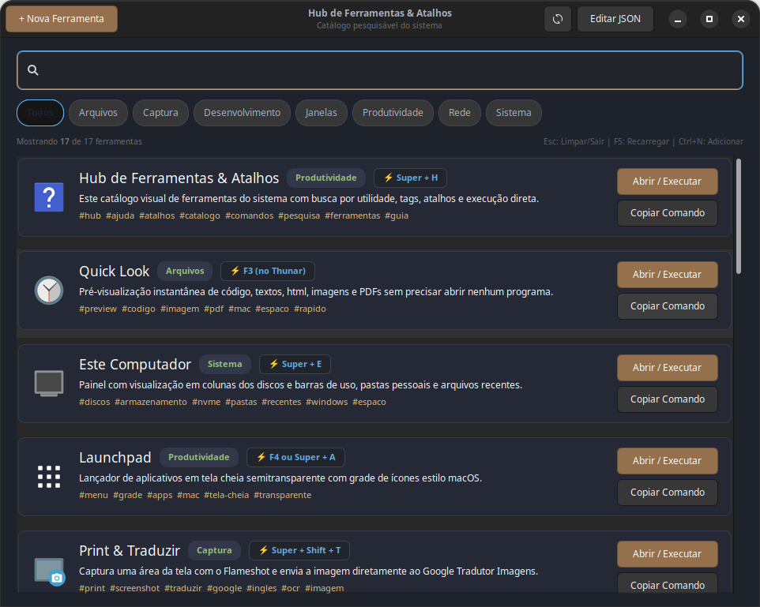
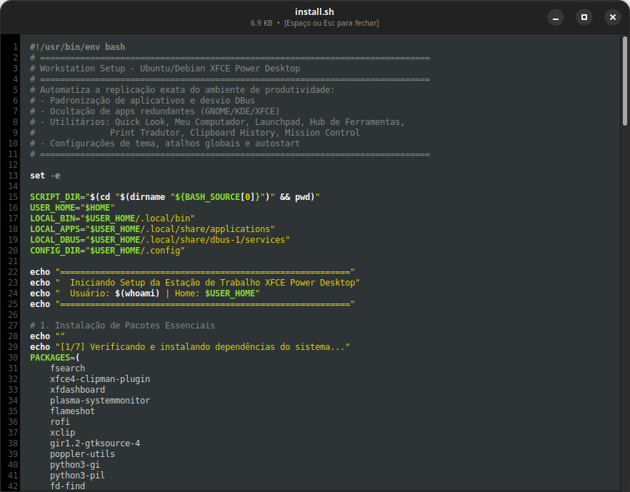
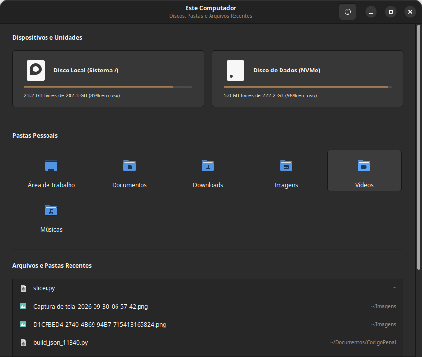
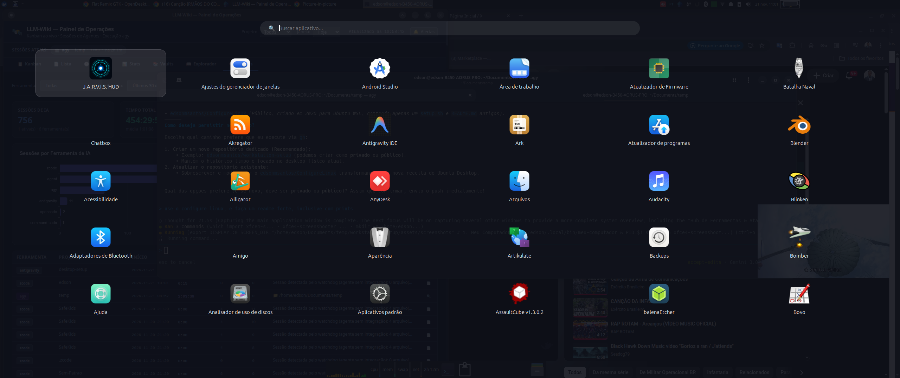
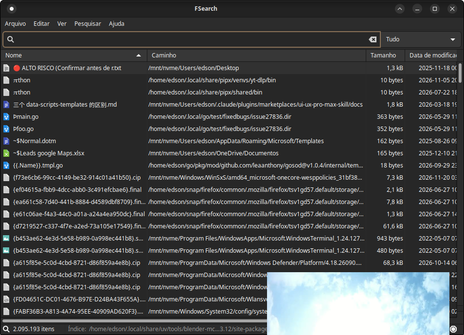
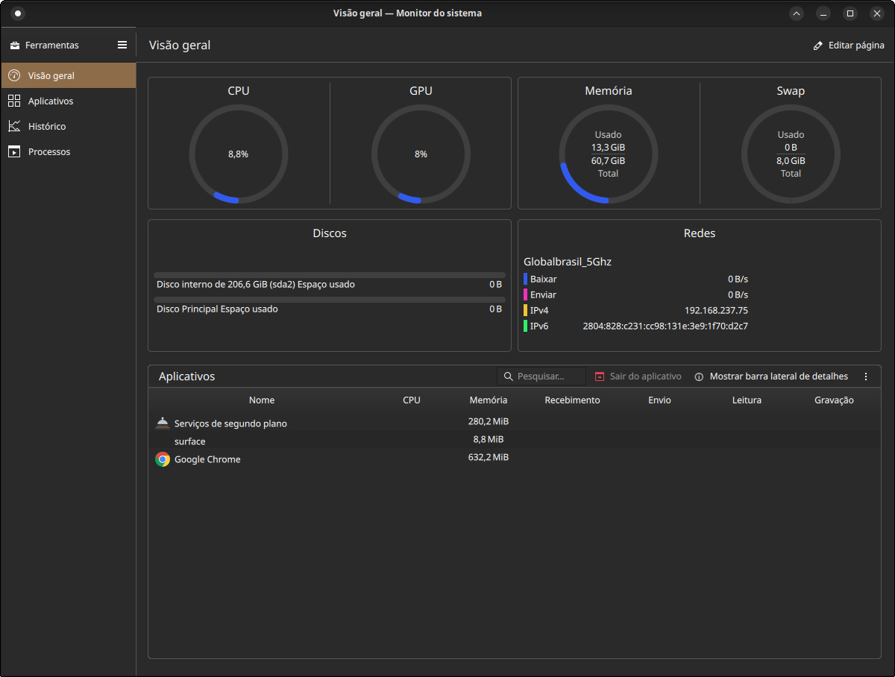

# 🚀 Ubuntu / Debian XFCE Power Desktop

<p align="center">
  
  
  
  
  
</p>

<p align="center">
  <b>Receita completa e automatizada para transformar uma instalação Linux XFCE em uma estação de trabalho de alta produtividade, combinando a consistência e elegância visual do macOS com os recursos ágeis de teclado do Windows 11 Power User.</b>
</p>

---

## 🎯 Por que esta configuração existe?

Muitos sistemas Linux com múltiplos ambientes (GNOME, KDE Plasma e XFCE instalados juntos) sofrem com:
- Dezenas de aplicativos redundantes nos menus (múltiplos terminais, editores de texto, visualizadores de PDF e gerenciadores de arquivo competindo entre si).
- Falta de atalhos e utilitários modernos essenciais de produtividade.
- Inconsistência nos tipos MIME e associações de arquivos.

Esta receita resolve tudo isso de forma **100% não-destrutiva**: padroniza aplicativos padrão, oculta redundâncias sem quebrar dependências de pacotes, e instala um conjunto coeso de ferramentas personalizadas desenvolvidas em Python 3 + GTK3.

---

## 📸 Galeria Visual & Funcionalidades

### 1. 🔍 Hub de Ferramentas & Atalhos (`Super + H`)
> *Nunca mais esqueça comandos, scripts ou atalhos da sua máquina.*

<p align="center">
  
</p>

- **Pesquisa Instantânea Multitermo:** Digite `traduzir`, `discos`, `ocr`, `gpu`, `preview` ou `rede` para filtrar em tempo real por nome, utilidade, tags ou atalhos.
- **Filtros Dinâmicos por Categoria:** Navegue rapidamente por *Arquivos*, *Captura*, *Desenvolvimento*, *Janelas*, *Produtividade*, *Rede* e *Sistema*.
- **Cadastro Dinâmico (`Ctrl + N`):** Formulário modal integrado para adicionar novos scripts e comandos ao catálogo sem precisar editar arquivos JSON manualmente.
- **Ações Rápidas:** Botões dedicados para **Abrir / Executar** diretamente com 1 clique e **Copiar Comando** para a área de transferência.

---

### 2. ⚡ Quick Look (`F3` no Thunar)
> *Pré-visualização instantânea estilo macOS sem abrir nenhum programa pesado.*

<p align="center">
  
</p>

- **Suporte Amplo:** Destaque de sintaxe para códigos-fonte (`.py`, `.js`, `.ts`, `.sh`, `.json`, `.yaml`, `.c`, etc.), Markdown renderizado, HTML, imagens (`png`, `jpg`, `svg`, `webp`) e documentos PDF multipágina.
- **Navegação Ágil:** Setas direcionais para folhear páginas de PDFs e fechar instantâneo com `Space`, `Esc` ou `Q`.

---

### 3. 💻 Este Computador (`Super + E`)
> *Painel de discos e armazenamento no estilo Windows 11.*

<p align="center">
  
</p>

- **Visualização em Colunas:** Exibe todas as partições montadas (Root, NVMe, Discos Externos) com espaço livre/total e barra de progresso visual (destaque em vermelho automático caso o uso ultrapasse 90%).
- **Pastas Pessoais & Arquivos Recentes:** Acesso imediato a Documentos, Downloads e lista integrada de arquivos recentes abertos pelo usuário.

---

### 4. 🚀 Launchpad Translúcido (`Super + A` ou `F4`)
> *Gaveta de aplicativos em tela cheia com estética moderna do macOS.*

<p align="center">
  
</p>

- Fundo escuro com **88% de translucidez**, grade espaçada de ícones em 64px e campo de busca inteligente com filtro em tempo real.

---

### 5. 🔎 Busca Instantânea Everything (`Ctrl + Alt + B` ou `Super + S`)
> *Encontre qualquer arquivo em microssegundos em qualquer disco.*

<p align="center">
  
</p>

- Indexação calibrada do `FSearch` em todo o disco Home e partições secundárias (NVMe), ignorando automaticamente diretórios lixo (`node_modules`, `.cache`, `.git`, `.venv`).

---

### 6. 📊 Monitor do Sistema Avançado com GPU & Rede (`Ctrl + Shift + Esc`)
> *Gerenciador de tarefas completo com métricas detalhadas em tempo real.*

<p align="center">
  
</p>

- Gráficos de GPU dedicada NVIDIA (GTX 1650 Super), CPU, Memória RAM e tráfego de download/upload discriminado por processo individual.

---

## ⌨️ Tabela Mestra de Atalhos Globais

| Atalho | Ação / Utilitário | Descrição |
|---|---|---|
| **`Super + H`** | **Hub de Ferramentas** | Catálogo pesquisável com tags, atalhos e execução direta |
| **`Super + J`** | **J.A.R.V.I.S. HUD** | Assistente neural holográfico com telemetria e controle por voz |
| **`Super + E`** | **Este Computador** | Painel de discos com barras de uso, pastas e arquivos recentes |
| **`Super + A`** ou **`F4`** | **Launchpad** | Gaveta de aplicativos em tela cheia semitransparente |
| **`Super + V`** | **Histórico de Clipboard** | Menu no cursor com últimos 50 textos e 10 imagens (com auto-paste) |
| **`Super + Tab`** | **Mission Control** | Visão de tarefas imersiva com espalhamento de janelas e miniaturas |
| **`Super + T`** | **Ghostty Terminal** | Terminal moderno acelerado por GPU com tema TokyoNight e fonte Hack |
| **`Super + Shift + T`** | **Print & Traduzir** | Captura área com Flameshot e envia ao Google Tradutor Imagens |
| **`Ctrl + Alt + B`** | **FSearch (Everything)** | Busca instantânea indexada em microssegundos em todo o disco |
| **`Ctrl + Espaço`** | **Ulauncher** | Barra estilo Spotlight / Raycast para comandos rápidos |
| **`Ctrl + Shift + Esc`** | **Monitor do Sistema** | Plasma Systemmonitor com GPU NVIDIA, CPU, RAM e tráfego de rede |
| **`Ctrl + Shift + S`** | **Flameshot** | Captura de tela avançada com setas, caixas e borrão de dados |
| **`F3`** (no Thunar) | **Quick Look** | Visualização instantânea de códigos, textos, imagens e PDFs |

---

## 🚀 Instalação Rápida em Nova Máquina

O processo é totalmente automatizado e idempotente:

```bash
# 1. Clonar o repositório
git clone https://github.com/edsonmsantos/ConfigureLinux.git ~/ConfigureLinux
cd ~/ConfigureLinux

# 2. Executar o instalador
chmod +x install.sh
./install.sh
```

### O que o instalador faz automaticamente:
1. **Instala pacotes essenciais:** `fsearch`, `xfce4-clipman-plugin`, `xfdashboard`, `plasma-systemmonitor`, `flameshot`, `rofi`, `xclip`, `gir1.2-gtksource-4`, `poppler-utils`, `python3-gi`, `python3-pil`, `fd-find`, `jq`, `curl`.
2. **Instala os utilitários:** Copia os scripts para `~/.local/bin/` e cria o symlink `fd -> /usr/bin/fdfind`.
3. **Padroniza aplicações padrão:** Configura `~/.config/mimeapps.list` para abrir arquivos sempre nas aplicações de referência (Thunar, Ghostty, Chrome, VS Code, MarkText, Gwenview, Okular, Showtime).
4. **Desvio de DBus do Gerenciador de Arquivos:** Cria `org.freedesktop.FileManager1.service` para garantir que ações externas ("Abrir na pasta" do Chrome ou VS Code) chamem o Thunar em vez do Nautilus.
5. **Deduplicação Não-Destrutiva de Menus:** Aplica `NoDisplay=true` para ocultar 21 duplicatas conflitantes sem remover pacotes do sistema.
6. **Registra todos os atalhos globais:** Aplica via `xfconf-query` sem necessidade de reinicialização da máquina.
7. **Ativa Clipboard com Auto-Paste:** Configura o XFCE Clipman para colar no aplicativo ativo e abrir na posição do cursor.
8. **Inicia serviços de segundo plano:** Sobe `xfdashboard -d` e recarrega os aceleradores do Thunar.

---

## 📁 Arquitetura do Repositório

```
ConfigureLinux/
├── install.sh                  # Script instalador mestre idempotente
├── README.md                   # Documentação completa com galeria
├── assets/
│   └── screenshots/            # Capturas de tela dos utilitários
│       ├── hub-ferramentas.png
│       ├── meu-computador.png
│       ├── quicklook.png
│       ├── launchpad.png
│       ├── fsearch.png
│       └── plasma-systemmonitor.png
├── bin/                        # Utilitários executáveis (~/.local/bin/)
│   ├── hub-ferramentas         # Hub pesquisável com tags e atalhos (Python GTK3)
│   ├── quicklook               # Preview instantâneo estilo macOS F3 (Python GTK3)
│   ├── meu-computador          # Painel de discos e arquivos recentes (Python GTK3)
│   ├── launchpad               # Gaveta de aplicativos em tela cheia (Rofi)
│   ├── flameshot-translate     # Captura de área com envio ao Google Tradutor
│   └── toggle-taskview         # Alternador do Mission Control (xfdashboard)
├── config/                     # Arquivos de configuração (~/.config/)
│   ├── app-catalog/tools.json  # Catálogo com 17 ferramentas cadastradas
│   ├── rofi/launchpad.rasi     # Tema escuro translúcido do Launchpad
│   ├── fsearch/fsearch.conf    # Calibração do índice de busca FSearch
│   ├── ghostty/config          # Configuração do terminal Ghostty (TokyoNight + Hack)
│   ├── Thunar/                 # Ações customizadas (uca.xml) e atalhos (accels.scm)
│   ├── autostart/              # Lançadores automáticos do sistema
│   └── mimeapps.list           # Associação padrão de tipos MIME
├── applications/               # Lançadores do sistema (~/.local/share/applications/)
│   └── overrides/              # Entradas com NoDisplay=true para deduplicação
└── dbus-services/              # Desvio do DBus org.freedesktop.FileManager1 para Thunar
```

---

## 🛠️ Personalização e Extensão

### Adicionar uma nova ferramenta ao Hub:
- Pressione **`Super + H`** e clique em **`+ Nova Ferramenta`** (ou `Ctrl + N`).
- Preencha o nome, comando, atalho, categoria, descrição e tags.
- A ferramenta fica imediatamente disponível e pesquisável.
- Se preferir editar em lote, clique no botão **"Editar JSON"** na barra superior para abrir [tools.json](file:///home/edson/.config/app-catalog/tools.json) diretamente no seu editor de código.

---

## 📄 Licença

Distribuído sob a licença MIT. Sinta-se livre para usar, customizar e estender no seu próprio ambiente.
